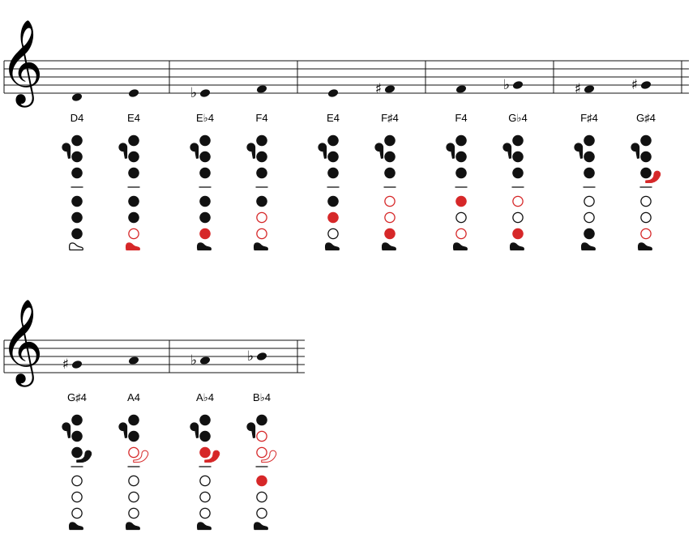
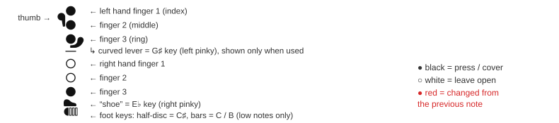

# 🎶 Flute Fingering

[](../../actions/workflows/tests.yml)


Takes a score and automatically draws the **concert flute fingering** under every note,
in the style of the [Woodwind Fingering Guide](https://www.wfg.woodwind.org/flute/) charts.
The score itself is engraved in full (rhythms, beams, ties, key and time signatures,
repeats) by [Verovio](https://www.verovio.org).

Accepts **MusicXML**, a **simple text format**, and also **PDFs and images**.

<p align="center">
  
</p>

Keys shown in **red** are the ones that change from the previous note, so you can see
which finger to move.

## Contents

- [Installation](#installation)
- [Usage](#usage)
- [Input formats](#input-formats)
- [Reading the diagram](#reading-the-diagram)
- [PDFs and images](#pdfs-and-images)
- [Library usage](#library-usage)
- [Project structure](#project-structure)
- [Development](#development)
- [Limitations](#limitations)
- [License](#license)

## Installation

Requires **Python 3.10+**. The only dependency, [Verovio](https://pypi.org/project/verovio/)
(music engraving), is installed automatically by pip.

```bash
pip install git+https://github.com/GustavoSanches55/sheet-to-flute-fingering.git
```

Or from a local clone:

```bash
git clone https://github.com/GustavoSanches55/sheet-to-flute-fingering.git
cd sheet-to-flute-fingering
pip install .            # basic
pip install ".[image]"   # + Pillow, to upscale small images (optional)
```

This installs the `flute-fingering` command. If your terminal says the command is not
recognized, pip's `Scripts` folder is not on your `PATH`; use
`python -m flute_fingering` instead (pip prints that folder's location when installing).

## Usage

```bash
flute-fingering my_song.musicxml --open
```

The result is an HTML page (`my_song_fingering.html`) that you can open in a browser or print.

| Option | Description |
|---|---|
| `-o file.html` | output file |
| `--open` | open the result in the browser |
| `--audiveris PATH` | path to Audiveris, if it is not found automatically |
| `--version` | show the version |

## Input formats

| Format | Extensions | Needs anything extra? |
|---|---|---|
| MusicXML (MuseScore, Finale, Sibelius...) | `.musicxml` `.xml` `.mxl` | no |
| Plain text | `.txt` | no |
| PDF or image | `.pdf` `.png` `.jpg` `.jpeg` `.tif` `.tiff` `.bmp` | [Audiveris](#pdfs-and-images) |

### Text format

```text
title: Ode to Joy
F#4 F#4 G4 A4 | A4 G4 F#4 E4 | D4 - D4 E4
```

- note = letter (`A`–`G`) + optional accidental (`#` or `b`) + octave (`C4` = middle C)
- `|` separates measures, `-` is a rest, lines starting with `#` are comments

See [`examples/scale_and_intervals.txt`](examples/scale_and_intervals.txt).

## Reading the diagram

<p align="center">
  
</p>

- **Black**: press the key / cover the hole
- **White**: leave open
- **Red**: changed from the previous note

The G♯ key and the foot keys (C♯, C, B) only appear on the notes that use them.

## PDFs and images

Notes are recognized by [Audiveris](https://github.com/Audiveris/audiveris), a free,
open source program that runs **separately** from this project. It is optional and only
needed for PDFs and images.

```bash
# Windows
winget install audiveris.org.Audiveris
```

On other systems, download it from <https://github.com/Audiveris/audiveris/releases>.
The program looks for Audiveris on the `PATH` and in common install locations. If it is
somewhere else, use `--audiveris PATH` or the `AUDIVERIS` environment variable.

```bash
flute-fingering my_song.pdf --open
```

- The recognized score is saved as `<name>_recognized.mxl`. If a note comes out wrong,
  open that file in [MuseScore](https://musescore.org), fix it and run the program again
  on the corrected `.mxl`.
- Small images (e.g. screenshots) are upscaled automatically before recognition if
  [Pillow](https://pypi.org/project/pillow/) is installed.
- Works best with clean digital scores. Skewed photos or poor scans may cause errors.

## Library usage

```python
from flute_fingering import read_score, render_html, fingering, Note

score = read_score("examples/ode_to_joy.musicxml")
page = render_html(score)

fingering(Note("F", 1, 4))   # closed keys for F♯4
# frozenset({'T', 'L1', 'L2', 'L3', 'R3', 'Eb'})
```

## How it works

1. The score is read and reduced to its first part. Plain text is converted to MusicXML
   (one quarter note per note); PDFs and images are converted by Audiveris.
2. Each note gets its name (e.g. `F♯4`) as a lyric. Verovio lays lyrics out without
   collisions, which spreads the notes far enough apart for the diagrams.
3. Verovio engraves the score to SVG. The real pitch of each note, including the key
   signature, comes from Verovio's MEI export.
4. Every line of music is moved down to make room, and a fingering diagram is drawn
   under each note name.

## Project structure

```text
.
├── flute_fingering/        # Python package
│   ├── cli.py              # command line
│   ├── reader.py           # MusicXML and text reading
│   ├── engrave.py          # full notation with Verovio + diagram placement
│   ├── diagram.py          # fingering diagram drawing (SVG) and legend
│   ├── fingerings.py       # fingering chart (Boehm system)
│   ├── render.py           # HTML page
│   ├── notes.py            # Note class
│   ├── omr.py              # PDF/image via Audiveris (optional)
│   └── errors.py
├── docs/                   # README images (regenerate with generate_images.py)
├── examples/               # example scores
├── tests/                  # tests (unittest)
└── pyproject.toml
```

## Development

```bash
python -m unittest discover -s tests -v   # run the tests
python docs/generate_images.py            # regenerate the README images
```

Tests run automatically on GitHub Actions (Linux and Windows) on every push.

## Limitations

- **Concert flute** only (not recorder).
- Range **B3 to A6**. Notes outside it are marked "out of range".
- When a note has more than one fingering, the most common one is used. For example,
  B♭ uses right hand finger 1, not the thumb B♭ lever.
- Only the first part (instrument) of the score is read.
- Lyrics in the original score are replaced by the note names.
- Grace notes and the lower notes of chords get no diagram.

## License

[MIT](LICENSE). Third-party tools keep their own licenses: Verovio (LGPLv3, installed
from PyPI) and Audiveris (AGPLv3, optional, installed separately). Neither is included
in this repository.
